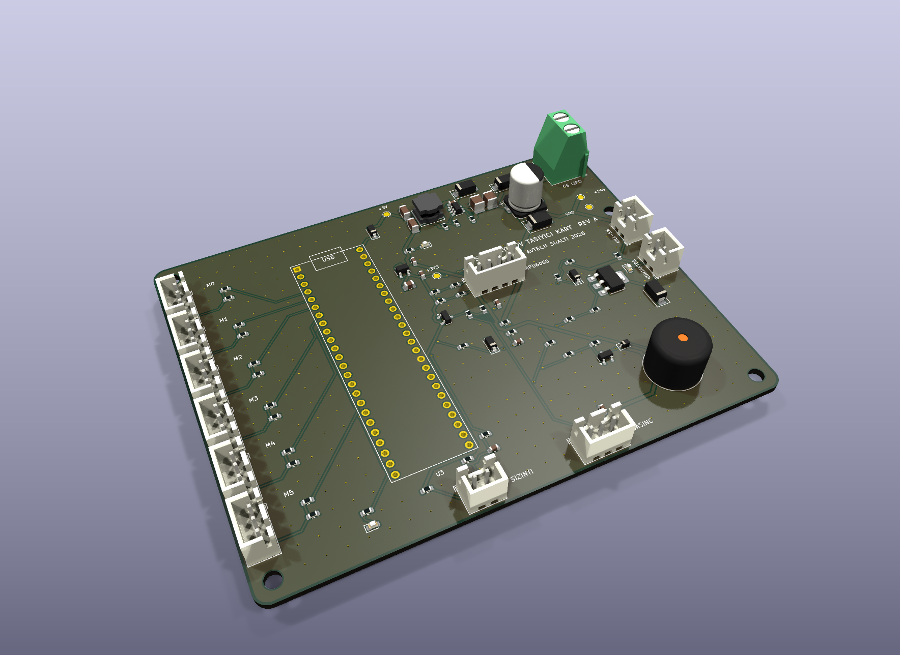

# Stingray ROV

CU AVTECH su alti takimi tarafindan TEKNOFEST icin gelistirilen 6 iticili su alti aracinin (ROV) kontrol yazilimi ve tasiyici kart tasarimi. Proje Kritik Tasarim Raporu (KTR) asamasini gecmistir.

Sistem iki katmandan olusur:

- Teensy 4.1 (`teensy/`): ESC PWM surusu, IMU ve analog sensor okumalari, donanimsal/yazilimsal emniyet kilitleri.
- Jetson Orin Nano (`jetson/`): ROS 2 tabanli durum kestirimi (EKF ve derinlik Kalman filtresi), derinlik/yaw PID kontrolculeri, su alti goruntu isleme ve gorev durum makinesi.

## Teensy 4.1 Firmware (`teensy/`)

Ayni surucu katmanini (`stingray_teensy/`) kullanan iki farkli zamanlama yapisi vardir:

- `freertos` ve `freertos_carrier`: 5 oncelikli FreeRTOS gorevi (1 kHz kontrol, 1 kHz IMU, 1 kHz RX / 50 Hz TX seri haberlesme, 100 Hz basinc/batarya/sizinti okuma, 10 Hz izleme). Paylasilan durum ve ADC erisimi mutex korumali calisir; donanim watchdog yalnizca tum gorevler olay grubuna (event group) bit bildirdiginde beslenir.
- `superloop` ve `superloop_carrier`: Zaman dilimli tek dongu (`stingray_teensy.ino`).

Surucu ve sinyal isleme detaylari:

- Motor surucusu (`motor_driver.cpp`, `frame_codec.cpp`): 6x ESC PWM cikisi (1100-1900 us, 1500 us notr). Ani akim sicramalarini ve mekanik darbe momentini sinirlamak icin 20 us/ms degisim hizi sinirlayicisi (slew-rate limiter) ve +-12 us notr olu bolge uygulanir.
- IMU (`imu_sensor.cpp`, `dsp_filter.cpp`): 400 kHz I2C uzerinden MPU6050 okunur. 1 kHz yaw hizi kanalinda fircasiz iticilerin olusturdugu 120 Hz govde titresimini bastirmak icin 2. derece IIR Biquad centik (notch) filtre ve 35 Hz Butterworth alcak geciren filtre kaskadi kullanilir.
- Basinc / derinlik (`depth_sensor.cpp`): 0-1.6 MPa ratiometric basinc sensoru (SEN0257) 5-orneklik kayan medyan + EMA filtresinden gecirilerek hidrostatik derinlige cevrilir.
- Seri protokol (`frame_codec.cpp`): CRC-8 (polinom 0x07) korumali sabit uzunluklu ikili cerceveler (15 bayt komut `0xAA 0x55`, 16 bayt telemetri `0xBB 0x66`). Kayan pencereli ayristirici bozuk baytlardan sonra senkronizasyonu kaybetmeden devam eder.
- Emniyet (`safety_monitor.cpp`): 500 ms icinde gecerli paket gelmezse motorlar notre cekilir. Rev A tasiyici kartta (`CARRIER_BOARD_REV=1`) manyetik kill-switch (`Pin 36`), ESC kontaktor surucusu (`Pin 38`) ve su sizintisi durumunda acil satiha cikis mantigi bulunur.

## Jetson ROS 2 Paketi (`jetson/src/`)

- `serial_bridge_node`: Teensy ile USB seri hat uzerinden ikili cerceve alisverisi.
- `sensor_node`: Basinc sifirlama kalibrasyonu, `[derinlik, dikey hiz]` uzerinde 2 durumlu Kalman filtresi (`depth_filter.py`) ve `[x, y, u, v, yaw, gyro_bias]` uzerinde kuadratik hidrodinamik suruklenme modelli 6 durumlu su alti EKF (`ekf_navigation.py`).
- `controller_node`: 50 Hz derinlik ve yaw PID kontrolculeri (anti-windup ve Kalman hiz tureviyle) ve 45 derece X-konfigurasyonlu 6 itici dagitim matrisi.
- `vision_node`: Su alti kirmizi kanal zayiflamasi icin Gray-World renk dengesi, LAB uzayinda CLAHE kontrast iyilestirme, kapi/samandira aci-mesafe kestirimi ve boru hatti takibi (`vision_pipeline.py`).
- `mission_node` ve `safety_node`: Gorev durum makinesi ve derinlik/pil/sizinti denetimi.

## Tasiyici Kart (`hardware/`)



Teensy 4.1 ve su alti sensor/ESC baglantilari icin 2 katmanli KiCad PCB tasarimi (Rev A, 110x85 mm):

- 6S Li-Po giris korumasi (`F1` 1 A sigorta, `D1` SS16 ters polarite diyodu, `D2` SMBJ30CA TVS, `C1` 47 uF).
- `LMR16006X` (700 kHz, 5 V buck) ve `AP2112K-3.3` (3.3 V sensor LDO), `D4` (B5819W) USB/VIN izolasyonu.
- 6x ESC PWM konnektoru (`J5..J10`, BEC pini bos birakilarak toprak dongusu onlenir, 220 ohm seri + 100k pull-down).
- 5 V basinc sensoru gerilim bolucusu ve `BAT54S` klempi (`J2`), 400 kHz I2C MPU6050 hatti (`J3`), su sizinti probu (`J4`) ve 68k/10k 6S batarya ADC bolucusu.
- Su gecirmez NC manyetik kill-switch (`J11`) ile seri bagli ana itici kontaktor bobini (`J12`, `Q2` BCP56-16).

Tasarim hesaplari `hardware/DESIGN.md`, konnektor tablolari `hardware/WIRING.md`, uretim dosyalari (Gerber, BOM, CPL, sematik PDF) `hardware/output/` altindadir.

## Derleme ve Testler

Donanim veya ROS kurulumu olmadan calisan C++ ve Python birim testleri:

```bash
cmake -S teensy/test -B build/test && cmake --build build/test && ctest --test-dir build/test --output-on-failure

python3 jetson/test/test_protocol.py
python3 jetson/test/test_depth_filter.py
python3 jetson/test/test_ekf_navigation.py
python3 jetson/test/test_vision.py
python3 jetson/test/test_controller.py
```

Teensy derlemesi:

```bash
cd teensy
pio run -e freertos
pio run -e freertos_carrier
pio run -e superloop
pio run -e superloop_carrier
```
