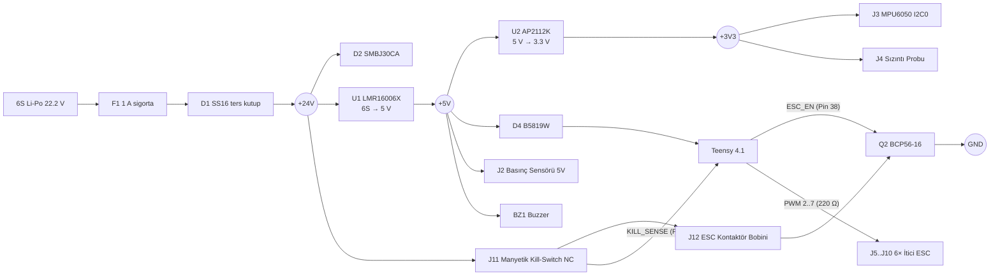

# Tasarım notları — Stingray ROV taşıyıcı kart Rev A

> **Durum: Rev A, tasarım aşamasında. Kart henüz üretilmedi ve hiçbir parçası donanımda test edilmedi.** Aşağıdaki değerler datasheet'lerden ve hesaptan gelir; ölçülmüş değer değildir. Bu notlar, üretimden önce yapılacak tasarım incelemesinin girdisidir.

## 1. Kart neden var?

Stingray su altı aracı bugün sızdırmaz akrilik tüp içinde Teensy 4.1'e elle lehimlenmiş kablo demetleriyle (`docs/masa_testi.md`, `teensy/stingray_teensy/config.h`) bağlanıyor. Mevcut bağlantıları gözden geçirince su altı operasyonunda güvenilirliği tehdit eden altı elektriksel sorun ortaya çıktı; kartın her bloğu bunlardan birini çözüyor:

| Sorun | Risk | Karttaki çözüm |
|-------|------|----------------|
| DFRobot `SEN0257` basınç sensörü 5 V ile çalışır ve 0.5–4.5 V çıkış verir; Teensy 4.1 pinleri 3.3 V sınırındadır | Kablo üstündeki ayrık 10k-10k dirençlerin GND bacağı tüp içinde koparsa Pin 16 (`A2`) 4.5 V görür ve ADC yanar | Kart üstünde %1 `10 kΩ / 10 kΩ` bölücü + `100 nF` alçak geçiren filtre (`fc ≈ 318 Hz`) + `BAT54S` çift Schottky kıskaç (`GND` ve `+3V3`) |
| 6S Li-Po batarya (22.2 V nominal, 25.2 V dolu) doğrudan bölücüyle Pin 15 (`A1`) ADC'sine giriyor | 6 adet fırçasız iticinin su altında ani yön değişimlerinde oluşan rejeneratif gerilim sıçramaları (>30 V) ADC pinine ulaşabilir | `68 kΩ / 10 kΩ` (%1) bölücü + `100 nF` filtre + `BZT52C3V3` 3.3 V zener kıskaç + `1 kΩ` seri koruma |
| Su sızıntı probu (`Pin 14 / A0`) akım sınırlamasız çıplak elektrotlardan oluşuyor | Tuzlu su sızıntısında `+3V3` hattı düşük empedansla yüklenebilir; kuru ortamda ise açık uçlu kablo ESC gürültüsü kaparak sahte sızıntı alarmı üretebilir | `+3V3` hattında `10 kΩ` seri akım sınırlama (`< 0.33 mA`), `47 kΩ` pull-down, `100 nF` gürültü filtresi ve `1 kΩ` seri direnç |
| `MPU6050` IMU, 400 kHz Fast-Mode I2C (`Pin 18/19`) üzerinde dahili zayıf pull-up ile sürülüyor | 6× ESC PWM anahtarlama gürültüsü altında yükselme süreleri bozulur, I2C hattı kilitlenebilir | Temiz sensör LDO'suna (`AP2112K-3.3`) bağlı `4.7 kΩ` harici pull-up dirençleri ve `33 Ω` seri sönümleme dirençleri |
| 6 adet ESC sinyal kablosundaki BEC 5 V uçları ve 3.3 V PWM hatları korumasız | Birden fazla ESC BEC 5 V hattının birleşmesi veya sinyal hattına kaçak vermesi Teensy'yi yakar; MCU resetteyken yüzen PWM pinleri ESC'leri tetikleyebilir | 3 pinli kilitli JST XH konnektörler (`J5..J10`, Pin 2 BEC ucu boşta), her kanalda `220 Ω` seri koruma ve `100 kΩ` pull-down |
| Şartnamedeki harici manyetik kill-switch ile yazılımsal acil durdurma (sızıntı, haberleşme kaybı, kritik pil) tek bir donanımsal kesici üzerinden birleşmiyor | Yalnızca yazılımda `1500 µs` nötr PWM göndermek, kısa devre olmuş bir ESC MOSFET'ini veya kilitlenmiş işlemciyi durduramaz | Harici NC manyetik anahtar (`J11`), ana itici kontaktör bobiniyle (`J12`) seri bağlıdır; mıknatıs çekilince yazılımdan bağımsız gücü keser. Ayrıca Teensy `ESC_EN` (`Pin 38`) ile bobini yazılımsal acil durumlarda da bırakabilir |

## 2. Gereksinimler

| Gereksinim | Değer | Kaynak |
|------------|-------|--------|
| Batarya | 6S Li-Po, 22.2 V nominal (18.0 V kesme – 25.2 V tam dolu) | KTR raporu (`Leopard Power 6S 16 Ah`) |
| 5 V yük | ~210 mA tahmini (aşağıdaki bütçe) | Hesap |
| 3.3 V yük (sensörler) | ~15 mA tahmini (`MPU6050` + sızıntı probu) | Hesap |
| Ana itici kontaktör bobini | 24 V DC nominal (18–26 V çalışma), ≤ 0.4 A | Seçilecek kontaktör/röleye göre |
| Mevcut firmware ile uyum | Tüm motor (`2..7`), analog (`A0..A2`) ve I2C (`18/19`) pinleri korunur; yeni pinler `11, 36..38` (`CARRIER_BOARD_REV=1`) | `config.h` |

### 5 V güç bütçesi (tahmini)

| Yük | Akım | Not |
|-----|------|-----|
| Teensy 4.1 (600 MHz) | ~100 mA | PJRC verisi (`D4` Schottky üzerinden) |
| `SEN0257` analog basınç sensörü | ~10 mA | DFRobot datasheet (< 10 mA @ 5 V) |
| `AP2112K` üzerinden 3.3 V hattı | ~15 mA | `MPU6050` (~3.9 mA) + I2C pull-up + sızıntı probu |
| Tüp içi aktif buzzer (`BZ1`) | ~30 mA | Yalnızca başlangıç arming ve alarm anında |
| Gösterge LED'leri (`D5`, `D9`) | ~8 mA | |
| **Toplam** | **~163 mA** | `LMR16006X` sınırı 600 mA → %27 yük |

Jetson Orin Nano bu karttan **beslenmez**; sızdırmaz tüp içindeki kendi yüksek akımlı (5 V / 3 A+) regülatöründen beslenir ve Teensy ile USB üzerinden haberleşir.

## 3. Blok şema



## 4. Güç girişi ve koruma

- **F1 — 1 A, 63 V SMD sigorta (1206).** Yalnızca lojik regülatör ve kontaktör bobin akımını taşır (~0.17 A + ≤ 0.4 A). 6× 15 A itici motor akımı bu karttan **geçmez**; ana kontaktör üzerinden doğrudan güç dağıtım barasına gider.
- **D1 — SS16 Schottky (60 V / 1 A), seri ters kutup koruması.** Batarya konnektörü ters takılırsa devre akım çekmez.
- **D2 — SMBJ30CA TVS.** Çalışma gerilimi (`Vrwm = 30 V`), tam dolu 6S Li-Po geriliminin (`25.2 V`) üzerindedir. Su altında iticilerin ani ters yöne frenlemesinde oluşan endüktif ve rejeneratif gerilim darbelerini kıskaçlar (`Vc ≈ 48.4 V`; `U1` 60 V, `C2/C3` 100 V, `C1` 63 V ve `Q2` 80 V sınırlarıyla uyumludur).
- **C1 — 47 µF 63 V elektrolitik.** Batarya kablosunun endüktansı ile seramik giriş kondansatörlerinin (`C2`, `C3`) oluşturduğu LC çınlamasını sönümler.

## 5. 6S (`+24V`) → 5 V buck (`U1`, `LMR16006XDDCR`)

- **Frekans seçimi (700 kHz X versiyonu):** Tam dolu 6S bataryada (`25.2 V`, `D1` sonrası `24.8 V`) görev oranı `D = 5 / 24.8 = 0.202`. 700 kHz'de açık kalma süresi `Ton = 288 ns` olup 80 ns minimum sınırının 3.6 katıdır.
- **Çıkış gerilimi:** `R2 = 54.9 kΩ`, `R3 = 10 kΩ` ile `VOUT = 0.765 × (1 + 54.9 / 10) = 4.97 V`.
- **Bobin (`L1 = 22 µH`, `Bourns SRN6045TA-220M`):** `VIN = 24.8 V` için dalgalanma akımı `ΔI = (24.8 − 5) × 0.202 / (22 µH × 700 kHz) = 0.26 A`.
- **Serbest geçiş diyodu (`D3 = SS16`) ve kondansatörler:** Girişte `2 × 2.2 µF 100 V X7R` (`C2`, `C3`), çıkışta `2 × 22 µF 10 V X7R` (`C5`, `C6`), bootstrap için `100 nF` (`C4`).

## 6. 3.3 V LDO (`U2`, `AP2112K-3.3`) ve USB/VIN izolasyonu

- **U2 (`AP2112K-3.3`):** `MPU6050` IMU ve sızıntı algılama devresini Teensy'nin dahili 3.3 V regülatöründen bağımsız, düşük gürültülü bir hattan besler.
- **D4 (`B5819W` Schottky):** Teensy 4.1 masa testinde veya araç içinde Jetson Orin Nano'ya USB kablosuyla bağlıyken, kartın `+5V` hattı ile Jetson USB 5 V hattının birbirini geri beslemesini önler.

## 7. Sensör ve ESC sinyal arayüzleri

### 6× İtici ESC PWM (`J5..J10`, `M0..M5`)
- Konnektör pin dizilimi: `Pin 1 = GND`, `Pin 2 = Boş (NC)`, `Pin 3 = PWM`. ESC'lerin dahili 5 V BEC çıkışları Pin 2'de boşta bırakılarak BEC'lerin birbirine veya kartın 5 V hattına çakışması donanımsal olarak engellenmiştir.
- Her kanalda `220 Ω` seri direnç (`R5..R10`) kablo yansımalarını sönümler ve olası bir ESC sinyal kısa devresinde Teensy pin akımını `3.3 V / 220 Ω = 15 mA` ile sınırlar.
- `100 kΩ` pull-down dirençleri (`R11..R16`), Teensy resetteyken veya açılışta pinler yüksek empedanstayken ESC girişlerini `0 V` seviyesinde tutar.

### Hidrostatik Basınç / Derinlik Sensörü (`J2`, `SEN0257`)
- Sensör `+5V` ile beslenir, `0.5 V` (0 MPa) ile `4.5 V` (1.6 MPa) arasında ratiometric çıkış verir.
- `R21 = 10 kΩ (%1)` ve `R22 = 10 kΩ (%1)` bölücüsü gerilimi tam yarıya (`0.25 V – 2.25 V`) indirir; bu oran mevcut yazılımdaki `DEPTH_VOLTAGE_DIVIDER = 0.5f` sabitiyle birebir aynıdır.
- `C11 = 100 nF` kondansatörü (`R_thevenin = 5 kΩ` ile `fc = 1 / (2π × 5 kΩ × 100 nF) = 318 Hz` alçak geçiren filtre) hem ESC anahtarlama gürültüsünü bastırır hem de Teensy SAR ADC'sinin örnekleme kondansatörüne düşük empedanslı yük kaynağı sağlar.
- `D6 = BAT54S` çift Schottky kıskaç, sensör hattında oluşabilecek aşırı gerilimleri `GND` ve `+3V3` hatlarına sınırlayarak `Pin 16 (A2)`'yi korur.

### Su Sızıntı Probu (`J4`, `Pin 14 / A0`)
- İletken probun1. ucu `R23 = 10 kΩ` üzerinden `+3V3` hattına, 2. ucu (`LEAK_NODE`) ise `R24 = 47 kΩ` pull-down ve `C13 = 100 nF` filtre üzerinden `R25 = 1 kΩ` ile `Pin 14 (A0)`'a bağlanır.
- Tüp kuruyken (`R_su = ∞`): `V_ADC = 0 V` (`ADC = 0`).
- Su sızıntısında (`R_su ≈ 10 kΩ` tatlı/tuzlu su): `V_ADC = 3.3 V × 47 / (10 + 10 + 47) = 2.31 V` (`ADC ≈ 2870 > LEAK_ADC_THRESHOLD = 2000`). Elektrotlar doğrudan metal gövdeye kısa devre olsa bile çekilecek maksimum akım `3.3 V / 10 kΩ = 0.33 mA`'dir.

### 6S Batarya Gerilim Ölçümü (`Pin 15 / A1`)
- `+24V` hattı (`D1` diyotundan sonra `VBAT − 0.35 V`), `R26 = 68 kΩ (%1)` ve `R27 = 10 kΩ (%1)` ile bölünür: bölme oranı `10 / (68 + 10) = 1 / 7.8`.
- Tam dolu 6S bataryada (`25.2 V`): `V_ADC = 24.85 / 7.8 = 3.19 V` (3.3 V ADC tam ölçeğinin %96.5'i).
- `C14 = 100 nF` filtre, `D7 = BZT52C3V3` zener kıskaç ve `R28 = 1 kΩ` seri direnç ADC pinini korur.

### `MPU6050` IMU (`J3`, `I2C0` 400 kHz)
- `SDA0 (Pin 18)` ve `SCL0 (Pin 19)` hatlarında `+3V3` LDO'suna bağlı `4.7 kΩ` pull-up dirençleri (`R17`, `R18`) ve `33 Ω` seri yansıma sönümleme dirençleri (`R19`, `R20`) bulunur.

## 8. Su geçirmez manyetik kill-switch ve itici kontaktörü

```
+24V ── J11 ── [Manyetik Kill-Switch NC] ── J11 ── KILL_RET ── J12 ── [Kontaktör Bobini] ── J12 ── COIL_N ── Q2 (BCP56) ── GND
                                                      │                                                        │
                                                      └── 47k/10k + 3.3V zener ── 1k ── Teensy pin 36   Teensy pin 38 (ESC_EN)
```

- **Donanımsal kesme:** Tüp dışındaki su geçirmez manyetik kill-switch (`J11`, normalde kapalı) çekildiğinde `KILL_RET` hattı fiziksel olarak açılır; Teensy veya yazılım ne durumda olursa olsun ana kontaktör (`J12`) düşer ve 6 ESC'nin enerjisi kesilir.
- **Yazılımsal kesme (`ESC_EN`, Pin 38):** Teensy; su sızıntısı (`leak_alarm`), haberleşme kopması (`comm_lost`), kritik batarya (`< 19.8 V`) veya görev watchdog sıfırlaması durumunda `Pin 38`'i `LOW` yaparak `Q2` (`BCP56-16`) üzerinden kontaktörü bırakır.
- **Durum okuma (`KILL_SENSE`, Pin 36):** `KILL_RET` gerilimi `47 kΩ / 10 kΩ` bölücü (`R32`, `R33`) ve `3.3 V` zener (`D12`) üzerinden Pin 36'dan okunur (`HIGH` = normal, `LOW` = kill-switch çekildi).

## 9. Firmware entegrasyonu

`teensy/stingray_teensy/config.h` içinde `CARRIER_BOARD_REV` bayrağı:

- `0` (varsayılan): Mevcut elle kablolama, davranış değişmez (`pio run -e freertos` ve `pio run -e superloop`).
- `1`: Rev A taşıyıcı kart (`pio run -e freertos_carrier` ve `pio run -e superloop_carrier`). `ESC_EN_PIN` (Pin 38), `KILL_SENSE_PIN` (Pin 36), `BUZZER_PIN` (Pin 37), `STATUS_LED_PIN` (Pin 11) ve `68k / 10k` batarya bölücü katsayısı (`BATT_DIV_NUM = 78, BATT_DIV_DEN = 10` + diyot düşümü telafisi) etkinleşir.

## 10. PCB

| Parametre | Değer |
|-----------|-------|
| Boyut | `110 × 85 mm`, köşeler `R3` (4 inç / 100 mm iç çaplı akrilik tüp kızaklarına uyumlu) |
| Katman | 2, FR-4 1.6 mm, 1 oz bakır |
| Kurallar | İz/boşluk `0.25 / 0.2 mm`, via `0.6 / 0.3 mm`, kenar boşluğu `0.5 mm` |
| GND | İki katmanda da bakır döküm ve 4 mm aralıklı dikiş (stitching) via'ları |
| Montaj | `4 × M3` delik (`H1..H4`) |

İz genişlikleri:

| Net | Genişlik | Akım |
|-----|----------|------|
| `VBAT_IN`, `VBAT_F`, `+24V`, `BUCK_SW` | `0.8 mm` | ≤ 0.8 A |
| `+5V`, `KILL_RET`, `COIL_N` | `0.6 mm` | ≤ 0.5 A |
| `GND`, `TEENSY_VIN` | `0.5 mm` | |
| `+3V3` | `0.4 mm` | ≤ 0.15 A |
| Sinyaller (`PWM`, `I2C`, `ADC`) | `0.25 mm` | |

## 11. Doğrulama

| Kontrol | Sonuç |
|---------|-------|
| Şematik ↔ tasarım bağlantı paritesi (`check_parity.py`) | `47 / 47` net birebir aynı |
| KiCad DRC (`KiCad 7` yerel + `KiCad 9` CI ERC/DRC) | `0` ihlal, `0` bağlı olmayan ped; ayrıntı: [output/drc_report.txt](output/drc_report.txt) |
| Datasheet hesapları | Bu dokümanda (bölüm 4–8) |

## 12. Siparişten önce inceleme listesi

- [ ] Teensy 4.1 pin sırasını PJRC pin kartıyla karşılaştır; footprint'i 1:1 çıktı alıp gerçek Teensy'yi üstüne koyarak kontrol et.
- [ ] Akrilik tüp kızak genişliğini ve `H1..H4` M3 montaj deliklerinin mekanik CAD ile uyumunu doğrula.
- [ ] `L1` (`SRN6045TA-220M`) doyma akımı ≥ 1 A mi?
- [ ] Kontaktör/röle bobini 6S Li-Po aralığında (`18–25.2 V` DC) ≤ 0.4 A çekiyor mu ve ana kontakları 6× ESC toplam akımına uygun mu?
- [ ] `SEN0257` basınç sensörü kablo sıralaması (`+5V / GND / SIG`) `J2` ile eşleşiyor mu?
- [ ] Gerber'leri üreticinin görüntüleyicisinde aç (katman, delik ve maske kontrolü).

## 13. Devreye alma (ilk enerji)

1. Teensy takılmadan, akım sınırlı laboratuvar güç kaynağıyla başla: `22.2 V`, `100 mA` sınır.
2. `TP2`'de `5 V` (`4.85 – 5.08 V`), `TP3`'te `3.3 V` ölç. Yeşil LED (`D5`) yanmalı.
3. `J11`'e manyetik kill-switch'i, `J12`'ye 24 V kontaktörü bağla. `Pin 38`'e `3.3 V` uygula → kırmızı LED (`D11`) yanmalı ve kontaktör çekmeli. Mıknatısı ayır → kontaktör düşmeli, `Pin 36` `LOW` olmalı.
4. `TP1` gerilimini değiştirerek (`18.0 V – 25.2 V`) `Pin 15 (A1)` üzerinde `1 : 7.8` oranını doğrula.
5. Teensy'yi tak, `pio run -e freertos_carrier -t upload` ile yükle ve sensörleri tek tek bağlayarak `ros2 topic echo /sensors/imu` üzerinden doğrula.
