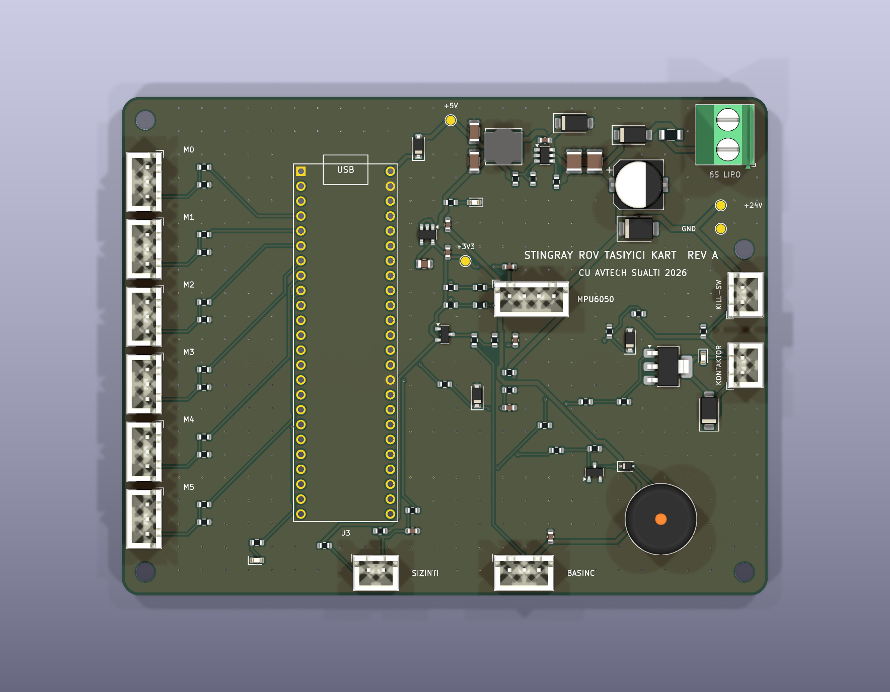
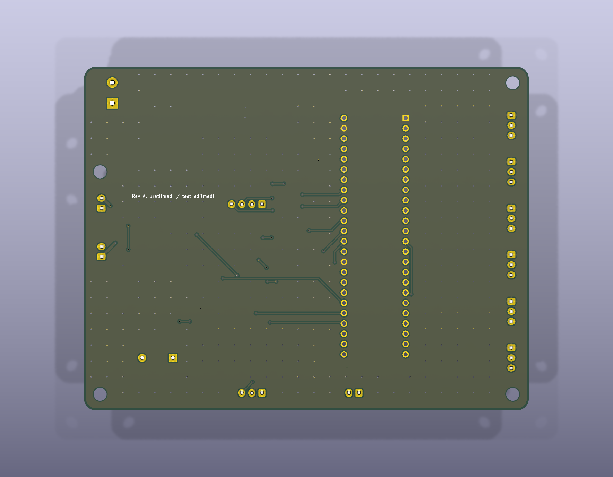
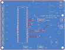

# Stingray ROV Tasiyici Kart (Rev A)

Teensy 4.1 tabanli 6 iticili ROV icin 2 katmanli (110x85 mm, FR-4, 1.6 mm, 1 oz bakir) tasiyici PCB tasarimi.

| Ust yuz | Izometrik |
| --- | --- |
|  |  |

| Alt yuz (GND dokumu) | Bakir + silkscreen yerlesimi |
| --- | --- |
|  |  |

Gorseller KiCad 9 3B goruntuleyicisinden (`kicad-cli pcb render`) uretilmistir; Teensy 4.1 soketi icin 3B model olmadigindan sadece header pedleri gorunur.

Kartin cozdugu temel elektriksel noktalar:

- 6S Li-Po (22.2 V nominal, 25.2 V tam dolu) girisinde 1 A sigorta (`F1`), SS16 ters polarite diyodu (`D1`), SMBJ30CA TVS (`D2`) ve 47 uF giris kondansatoru (`C1`).
- 6S hattan 5 V uretimi icin `LMR16006X` (700 kHz, 0.6 A buck, `U1`) ve 3.3 V sensor beslemesi icin `AP2112K-3.3` LDO (`U2`). Jetson USB 5 V hatti ile kartin 5 V hatti `D4` (B5819W) ile ayrilir.
- 5 V cikisli SEN0257 basinc sensorunun 3.3 V toleransli Teensy ADC pinine (`Pin 16 / A2`) 10k/10k bolucu (`R21`, `R22`), 100 nF filtre (`C11`) ve `BAT54S` Schottky klempi (`D6`) ile baglanmasi.
- 6x ESC PWM cikisinda (`J5..J10`) ESC BEC +5 V pininin bos birakilmasi, 220 ohm seri direnc ve MCU reset sirasinda ESC'leri sessiz tutan 100k pull-down.
- Disaridan mudahale edilebilen su gecirmez NC manyetik kill-switch (`J11`) ile ana itici guc kontaktoru bobininin (`J12`) seri baglanmasi. Miknatis cekildiginde kontaktor yazilimdan bagimsiz olarak duser; Teensy `T_KILL_SENSE` (`Pin 36`) ile durumu okur ve `T_ESC_EN` (`Pin 38`, `Q2` BCP56-16) ile kontaktoru acip kapatabilir.

## Dizin Yapisi

- `DESIGN.md`: Devre hesaplari, filtre ve bolucu secimleri, PCB kurallari.
- `WIRING.md`: Konnektor ve Teensy 4.1 pin eslemesi.
- `stingray-rov-carrier/`: KiCad proje, sematik ve PCB dosyalari.
- `output/`: Gerber + delik paketi, BOM, CPL (pick-and-place), sematik PDF ve DRC raporu.
- `gen/`: Tek kaynak netlist (`design.py`) uzerinden sematik ve PCB'yi ureten Python betikleri.

Yeniden uretmek icin:

```bash
cd hardware/gen
python3 build.py
```
